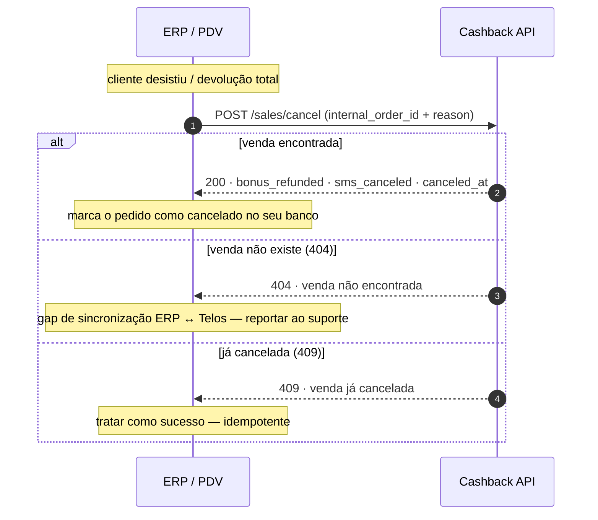

# Cancelamento de venda

Cliente desistiu, devolução total ou pedido cancelado no ERP: o cancelamento
devolve ao saldo o bônus usado, cancela os SMS vinculados e cancela o cashback
que a venda gerou.

::: info Devolveu só parte do pedido?
Devolução parcial e troca não são cancelamento: use a
[Troca e devolução parcial](./troca-devolucao).
:::

**Endpoint principal:** `POST /sales/cancel`, identificado pelo
`internal_order_id` — o mesmo número de pedido que o seu ERP enviou no
`/bonus/submit` e no `/sales/total`.

## Visão geral



## Passo a passo

1. **Cancele pelo `internal_order_id`**, nunca por um ID interno da Telos — a
   correlação entre a venda sua e a nossa é o número do pedido no seu ERP.

::: code-group

```bash [curl]
curl -s -X POST "$BASE_URL/sales/cancel" \
  -H "Authorization: Bearer $TOKEN" -H "Content-Type: application/json" \
  -d '{"internal_order_id":"PED-9002","reason":"Devolução total"}'
```

```php [Laravel]
$response = Http::withToken($token)->post("$baseUrl/sales/cancel", [
    'internal_order_id' => 'PED-9002',
    'reason' => 'Devolução total',
]);
```

:::

```json
{
    "status": true,
    "message": "Sale successfully canceled",
    "data": {
        "transaction_id": "PED-9002",
        "bonus_refunded": 30.00,
        "sms_canceled": 1,
        "canceled_at": "2026-10-21T14:30:00Z"
    }
}
```

2. **Interprete a resposta:**

| Campo | Significado |
| --- | --- |
| `bonus_refunded` | Bônus usado nesta venda que **voltou ao saldo** do cliente. É `0` quando a venda não usou bônus ou quando nada pôde voltar (o bônus usado era de outro pedido já cancelado, ou venceu) |
| `sms_canceled` | Quantidade de SMS vinculados à venda que foram cancelados |

O cashback que a venda **gerou** é cancelado e não entra no
`bonus_refunded`. Se o cliente já tinha usado esse cashback em outra compra,
ele não é cobrado: a loja assume o valor.

3. **Trate os erros:**

| Resposta | O que fazer |
| --- | --- |
| `200` | Pronto: marque o pedido como cancelado no seu banco |
| `409` | Venda/transação **já cancelada**: tratar como sucesso (idempotente) |
| `404` | Venda **não existe** na Telos: gap de sincronização ERP ↔ Telos (venda órfã) — reportar ao suporte com o `internal_order_id` |
| `400` | `internal_order_id` ausente no payload — corrigir |

## Checklist

- [ ] Cancelamento disparado pelo fluxo de devolução/desistência do ERP
- [ ] Usa o `internal_order_id` original do pedido
- [ ] `409` tratado como sucesso (cancelar duas vezes não é erro)
- [ ] `404` encaminhado ao suporte com o número do pedido
- [ ] Pedido marcado como cancelado no seu banco após o `200`
