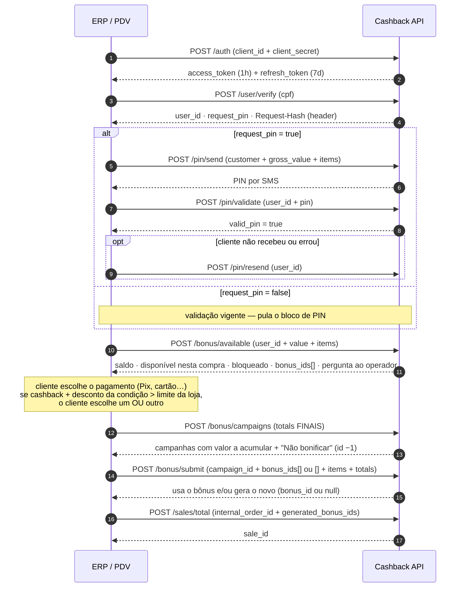
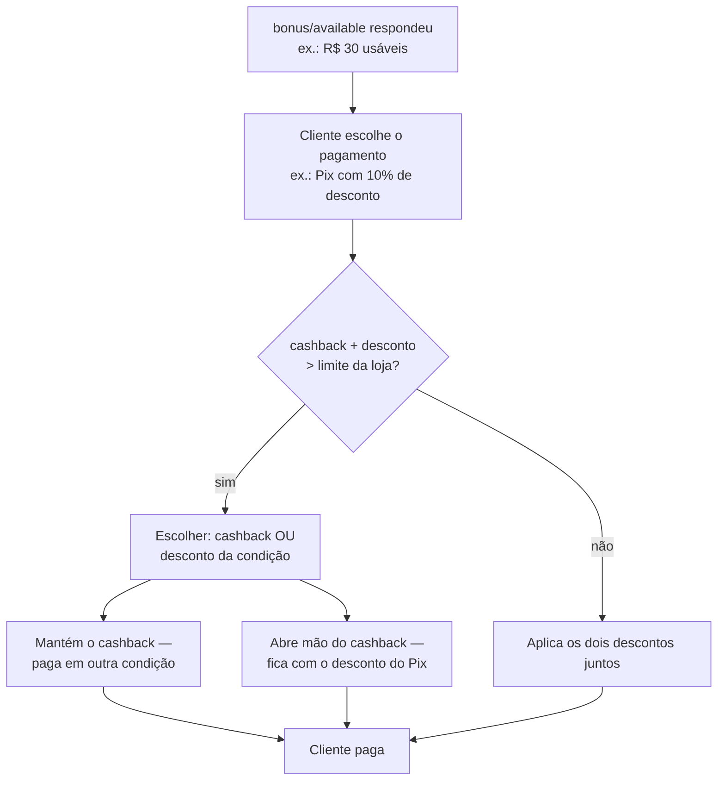

# Fluxo de compra

O caixa em si: o cliente está no balcão com os produtos, o operador chama o
cashback, o bônus entra como desconto e a venda é registrada.

A ordem das chamadas **depende do retorno do `/user/verify`**: o parâmetro
`request_pin` decide se o bloco de PIN entra ou não na jornada.

::: tip Caminho padrão — `request_pin = true` (PIN exigido)
Na maior parte das integrações a loja exige a validação por PIN. Ordem completa:

`/user/verify` → `/pin/send` → `/pin/validate` → `/bonus/available` →
*(pagamento no PDV)* → `/bonus/campaigns` → `/bonus/submit` → `/sales/total`
:::

::: info Caminho alternativo — `request_pin = false` (PIN não exigido)
Em alguns casos o cliente já está dentro da janela de validação e a loja
dispensa o PIN — a ordem pula o bloco inteiro:

`/user/verify` → `/bonus/available` → *(pagamento no PDV)* →
`/bonus/campaigns` → `/bonus/submit` → `/sales/total`
:::

::: warning Sempre se atente ao `request_pin`
Nunca presuma pelo histórico do cliente: o que define se você envia e solicita
o PIN é o `request_pin` devolvido pelo `/user/verify` **em cada venda**. E cada
passo prepara o estado que o próximo consome (`user_id`, `bonus_ids`, campanha
escolhida, totals finais) — chamar fora de ordem gera erro 400/404 — ou, pior,
venda sem bônus.
:::

## Visão geral



## Passo a passo

As chamadas abaixo usam a **homologação**:

```bash
BASE_URL="https://giftback.hom.teloscrm.com.br/api/v1"
TOKEN="eyJ0eXAi..."   # access_token do /auth (ver Primeiros passos)
```

### 1. Identifique o cliente pelo CPF

No início do atendimento do cashback, quando o operador digita o CPF:

::: code-group

```bash [curl]
curl -s -X POST "$BASE_URL/user/verify" \
  -H "Authorization: Bearer $TOKEN" -H "Content-Type: application/json" \
  -d '{"cpf":"11144477735"}'
```

```php [Laravel]
$response = Http::withToken($token)->post("$baseUrl/user/verify", [
    'cpf' => '11144477735',
])->throw()->json();

$userId = $response['data']['user_id'];
$requestPin = $response['data']['request_pin'];
$requestHash = $response->header('Request-Hash'); // guarde para a sessão
```

:::

```json
{
    "status": true,
    "message": "Success",
    "data": { "user_id": "0zXtCRB91brXqq92ud5KqQ==", "request_pin": true }
}
```

- `request_pin = true` → a loja exige PIN agora (primeira compra, validação
  expirada ou regra da loja): siga para o passo 2.
- `request_pin = false` → validação vigente: **pule direto para o passo 3**.
- O header `Request-Hash` da resposta identifica a sessão — guarde e envie nas
  chamadas seguintes.

A estratégia de PIN (quando é exigido, validade em dias) é configurada **por
loja** na Telos — o ERP só obedece ao `request_pin`.

### 2. Valide o cliente com o PIN por SMS (só se `request_pin = true`)

Envie o PIN por SMS com os dados do cliente e o carrinho atual:

::: code-group

```bash [curl]
curl -s -X POST "$BASE_URL/pin/send" \
  -H "Authorization: Bearer $TOKEN" -H "Content-Type: application/json" \
  -d '{
    "customer": {"country_code":55,"name":"Maria Souza","phone":"11988887777",
                 "document_type":"CPF","document_number":"11144477735"},
    "gross_value": 150.00,
    "items": [{"sku":"SKU-1","value_of":100,"value_per":100,"quantity":1}]
  }'
```

```php [Laravel]
$response = Http::withToken($token)->post("$baseUrl/pin/send", [
    'customer' => [
        'country_code' => 55, 'name' => 'Maria Souza',
        'phone' => '11988887777', 'document_type' => 'CPF',
        'document_number' => '11144477735',
    ],
    'gross_value' => 150.00,
    'items' => [['sku' => 'SKU-1', 'value_of' => 100, 'value_per' => 100, 'quantity' => 1]],
])->throw()->json();
```

:::

```json
{
    "status": true,
    "message": "Pin successfully sent",
    "data": {
        "user_id": "0zXtCRB91brXqq92ud5KqQ==",
        "request_pin": true,
        "text_pin": "TELOS Giftback: PIN 3885 - Ao passar pin você concorda com https://www.telosdigital.com.br/termos-uso"
    }
}
```

::: tip O clique repetido no "enviar" não é erro
O operador clicou de novo e o SMS ainda não chegou? Um `/pin/send` repetido em
menos de 60s (mesmo telefone, PIN ainda ativo) responde **200** com o **mesmo
PIN** — nenhum SMS novo é disparado. Se o SMS anterior **falhou**, a janela já
foi liberada e o novo envio dispara de verdade.
:::

O operador lança os 4 dígitos no PDV e você valida:

::: code-group

```bash [curl]
curl -s -X POST "$BASE_URL/pin/validate" \
  -H "Authorization: Bearer $TOKEN" -H "Content-Type: application/json" \
  -d '{"user_id":"0zXtCRB91brXqq92ud5KqQ==","pin":"3885"}'
```

```php [Laravel]
$response = Http::withToken($token)->post("$baseUrl/pin/validate", [
    'user_id' => $userId,
    'pin' => '3885',
])->throw()->json();

$validPin = $response['data']['valid_pin'];
$pinMaster = $response['data']['pin_master'];
```

:::

- `valid_pin = false` → PIN errado: deixe digitar de novo — o **mesmo PIN
  continua válido**, não precisa de novo envio.
- Cliente **não recebeu**? Clique em "enviar" de novo (comportamento acima) ou,
  após a janela de 60s, force com `/pin/resend` — que responde **429**
  `Aguarde 60 segundos antes de reenviar o PIN.` dentro da janela.

```bash
curl -s -X POST "$BASE_URL/pin/resend" \
  -H "Authorization: Bearer $TOKEN" -H "Content-Type: application/json" \
  -d '{"user_id":"0zXtCRB91brXqq92ud5KqQ=="}'
```

- `pin_master = true` → a validação foi feita com o PIN master (uso
  operacional, sem SMS). Campo informativo — o fluxo segue igual.

### 3. Consulte quanto de bônus vale ESTA compra

Com o carrinho montado e o PIN resolvido (se exigido):

::: code-group

```bash [curl]
curl -s -X POST "$BASE_URL/bonus/available" \
  -H "Authorization: Bearer $TOKEN" -H "Content-Type: application/json" \
  -d '{
    "user_id": "0zXtCRB91brXqq92ud5KqQ==",
    "value": 150.00,
    "items": [{"sku":"SKU-1","value_of":100,"value_per":100,"quantity":1}]
  }'
```

```php [Laravel]
$response = Http::withToken($token)->post("$baseUrl/bonus/available", [
    'user_id' => $userId,
    'value' => 150.00,
    'items' => [['sku' => 'SKU-1', 'value_of' => 100, 'value_per' => 100, 'quantity' => 1]],
])->throw()->json();

$bonusIds = $response['data']['bonus_ids']; // guarde o array INTEIRO
```

:::

```json
{
    "status": true,
    "message": "Success",
    "data": {
        "bonus_has": true,
        "bonus_balance": 50.00,
        "bonus_available": 30.00,
        "bonus_accumulate_flag": true,
        "bonus_accumulate_question": "O cliente tem bonus de R$ 30,00 disponivel. Deseja utilizar agora? (Este cliente está perdendo R$ 20,00 de bônus!)",
        "bonus_ids": ["nR1+ENnNxiJqmBr7iBMI+A==", "+6Z15u6ChtC8QTp8hylURA=="],
        "use_sku_rescue": false,
        "items": []
    }
}
```

| Campo | Uso no PDV |
| --- | --- |
| `bonus_has` | Cliente possui algum bônus acumulado |
| `bonus_balance` | Saldo total do cliente |
| `bonus_available` | Valor que **esta compra** pode usar — pode ser menor que o saldo |
| `bonus_balance − bonus_available` | Parte **bloqueada** nesta compra (mínimo de resgate, limite por compra) — é o que a pergunta avisa como "perda" |
| `bonus_accumulate_flag` | Se `false`, esta compra não pode usar bônus (prossiga com `bonus_ids: []`) |
| `bonus_accumulate_question` | Texto pronto para exibir ao operador e perguntar "usar agora?" |
| `bonus_ids` | **Todos** os IDs de bônus utilizáveis — guarde o array inteiro |

O operador pergunta ao cliente: **quer usar o cashback?** O uso só é
efetivado no `/bonus/submit`, depois do pagamento.

### 4. Condição de pagamento e limite de desconto (decisão do PDV)

O cliente diz como vai pagar: **Pix, cartão, dinheiro…**. Cada condição pode
ter desconto próprio no seu PDV (ex.: "Pix tem 10% off") — **essa regra é do
ERP, a API não conhece condições de pagamento**.



::: tip Exemplo numérico
Compra de R$ 100, cashback de R$ 30, Pix com 10% (R$ 10), limite de desconto
da loja de 30%: 30 + 10 = 40% → **estourou**. O operador negocia:

- **Mantém o cashback** → paga em outra condição. Depois: `bonus_ids` = todos
  os IDs, `crm_discounts = 30`, `other_discounts = 0`.
- **Abre mão do cashback** → fica com o desconto do Pix. Depois:
  `bonus_ids = []`, `crm_discounts = 0`, `other_discounts = 10`.
- **Dá para combinar** (não estourou) → segue com os dois.
:::

Depois da escolha, **o cliente paga** — e só então os `totals` da venda estão
definitivos.

### 5. Consulte as campanhas de acúmulo

Com a venda paga e os `totals` fechados, pergunte **quanto a compra acumula**:

```bash
curl -s -X POST "$BASE_URL/bonus/campaigns" \
  -H "Authorization: Bearer $TOKEN" -H "Content-Type: application/json" \
  -d '{
    "sales_type": "IN_STORE",
    "user_id": "0zXtCRB91brXqq92ud5KqQ==",
    "items": [{"sku":"SKU-1","value_of":100,"value_per":100,"quantity":1}],
    "totals": {"fee":0,"taxes":0,"subtotal":150.00,
               "crm_discounts":30,"other_discounts":0,"total":120.00}
  }'
```

A resposta é um **array de opções para o vendedor escolher** — e a opção
"Não bonificar" **sempre vem nele**:

```json
{
    "status": true,
    "message": "Success",
    "data": [
        {
            "id": 20628,
            "name": "Fidelidade",
            "subtitle": "Campanha de fidelidade da loja",
            "type": "fidelidade",
            "text": "R$ 3,60 para a próxima compra",
            "value": 3.60,
            "start_date": "2024-08-14 00:00:00",
            "end_date": "2024-09-13 23:59:59"
        },
        {
            "id": -1,
            "name": "Não bonificar",
            "subtitle": "Não bonificar",
            "type": "",
            "text": "Não bonificar",
            "value": 0,
            "start_date": "",
            "end_date": ""
        }
    ]
}
```

- `value` de cada campanha = **quanto o cliente acumula** naquela campanha —
  é o que o PDV mostra para o vendedor comparar.
- **Nenhuma campanha atinge a regra** (ex.: valor pago abaixo do mínimo de
  acúmulo)? A API devolve **uma única opção**, já explicando o motivo:

```json
{
    "status": true,
    "message": "Success",
    "data": [
        {
            "id": -1,
            "name": "Não bonificar - Valor mínimo compra R$ 50,00",
            "subtitle": "Valor mínimo para bonificação: R$ 50,00",
            "type": "",
            "text": "Não bonificar - Valor mínimo compra R$ 50,00",
            "value": 0,
            "start_date": "",
            "end_date": ""
        }
    ]
}
```

::: info Dois mínimos diferentes
**`valor_minimo_resgate`** (usar bônus — avaliado no `/bonus/available`) e
**`valor_minimo_acumulo`** (gerar bônus — avaliado no `/bonus/campaigns`) são
configurados por loja e independentes. Por isso uma compra pode "não poder
usar" e ainda assim "acumular".
:::

O vendedor seleciona a campanha mais vantajosa — ou "Não bonificar" — e
confirma.

### 6. Feche a venda

Executa as duas pontas: **usa** o bônus existente (se o cliente optou por
usar) e **gera** o bônus novo conforme a campanha escolhida:

::: code-group

```bash [curl]
curl -s -X POST "$BASE_URL/bonus/submit" \
  -H "Authorization: Bearer $TOKEN" -H "Content-Type: application/json" \
  -d '{
    "sales_type": "IN_STORE",
    "user_id": "0zXtCRB91brXqq92ud5KqQ==",
    "campaign_id": 20628,
    "pin_master": false,
    "bonus_ids": ["nR1+ENnNxiJqmBr7iBMI+A==", "+6Z15u6ChtC8QTp8hylURA=="],
    "internal_order_id": "PED-9001",
    "items": [{"sku":"SKU-1","value_of":100,"value_per":100,"quantity":1}],
    "payments": [{"system_name":"VISA","type":"CREDIT_CARD","value":120.0,"installments":1}],
    "totals": {"fee":0,"taxes":0,"subtotal":150.00,
               "crm_discounts":30,"other_discounts":0,"total":120.00}
  }'
```

```php [Laravel]
// Retry seguro: a chave é o internal_order_id — repetiu? 409 = já processou.
$response = Http::withToken($token)->post("$baseUrl/bonus/submit", [
    'sales_type' => 'IN_STORE',
    'user_id' => $userId,
    'campaign_id' => 20628,
    'pin_master' => false,
    'bonus_ids' => $bonusIds,       // todos os IDs recebidos, ou []
    'internal_order_id' => 'PED-9001',
    'items' => [['sku' => 'SKU-1', 'value_of' => 100, 'value_per' => 100, 'quantity' => 1]],
    'payments' => [['system_name' => 'VISA', 'type' => 'CREDIT_CARD', 'value' => 120.0, 'installments' => 1]],
    'totals' => ['fee' => 0, 'taxes' => 0, 'subtotal' => 150.00,
                 'crm_discounts' => 30, 'other_discounts' => 0, 'total' => 120.00],
]);

if ($response->status() === 409) {
    // Transação já processada: tratar como sucesso e seguir.
}
$bonusId = $response->json('data.bonus_id');
```

:::

```json
{
    "status": true,
    "message": "Successfully generated bonus",
    "data": {
        "bonus_id": "6m6AU/VuGMZablszkpr8/w==",
        "order_id": "N1zy1v2v+p4BdT/TyHCRAg==",
        "bonus_sku": ["ZVBycxzxb+p4BaTTyHSSAg=="],
        "bonus_generated": true,
        "bonus_value": 3.60
    }
}
```

- `campaign_id`: o `id` da campanha escolhida no passo 5. Escolheu **"Não
  bonificar"** (`id = -1`)? Envie `campaign_id: -1` (ou omita o campo).
- `bonus_ids`: **todos** os IDs recebidos no `/bonus/available` (cliente usou)
  **ou `[]`** (cliente não usou / não tinha).
- `bonus_generated = false` (e `bonus_id: null`) é **resposta de sucesso** — a
  venda processou mas não gerou bônus (campanha "Não bonificar", crédito
  R$ 0, sem campanha aplicável).

### 7. Registre a venda

Último passo, **sempre executado** — mesmo quando `bonus_generated = false` ou
quando a venda não teve nada de bônus. É ele que contabiliza a venda da loja:

::: code-group

```bash [curl]
curl -s -X POST "$BASE_URL/sales/total" \
  -H "Authorization: Bearer $TOKEN" -H "Content-Type: application/json" \
  -d '{
    "sales_type": "IN_STORE",
    "generated_bonus_ids": ["6m6AU/VuGMZablszkpr8/w=="],
    "internal_order_id": "PED-9001",
    "customer": {"country_code":55,"phone":"11988887777","name":"Maria Souza",
                 "document_type":"CPF","document_number":"11144477735"},
    "items": [{"sku":"SKU-1","value_of":100,"value_per":100,"quantity":1}],
    "totals": {"fee":0,"taxes":0,"subtotal":150.00,
               "crm_discounts":30,"other_discounts":0,"total":120.00}
  }'
```

```php [Laravel]
Http::withToken($token)->post("$baseUrl/sales/total", [
    'sales_type' => 'IN_STORE',
    'generated_bonus_ids' => array_filter([$bonusId]),
    'internal_order_id' => 'PED-9001',
    'customer' => [
        'country_code' => 55, 'phone' => '11988887777', 'name' => 'Maria Souza',
        'document_type' => 'CPF', 'document_number' => '11144477735',
    ],
    'items' => [['sku' => 'SKU-1', 'value_of' => 100, 'value_per' => 100, 'quantity' => 1]],
    'totals' => ['fee' => 0, 'taxes' => 0, 'subtotal' => 150.00,
                 'crm_discounts' => 30, 'other_discounts' => 0, 'total' => 120.00],
])->throw()->json('data.sale_id');
```

:::

Guarde o `sale_id` + `internal_order_id` no ERP: o cancelamento usa o
`internal_order_id` (ver [Cancelamento de venda](./cancelamento)).

## Erros deste fluxo

| Passo | Resposta | O que fazer |
| --- | --- | --- |
| `/user/verify` | `400 CPF inválido` | Corrigir o CPF no cadastro; não repetir igual |
| `/pin/send` | `429` (telefone mudou na janela ou PIN já validado) | Aguardar a janela de 60s — clique repetido normal responde 200 |
| `/pin/validate` | `404 Usuário não encontrado` | `user_id` da outra sessão — refazer o verify |
| `/bonus/available` | `404 Usuário não encontrado` | `user_id` não resolve — refazer o verify |
| `/bonus/submit` | `409 Transação já processada` | **Sucesso**: o pedido já passou; seguir para o `/sales/total` |
| `/bonus/submit` | `422 BONUS_VALUE_MINIMUM_NOT_MET` | Compra abaixo do mínimo: refazer com `bonus_ids: []` e seguir a venda |
| `/sales/total` | `500` | Retry com backoff — seguro, a chave é o `internal_order_id` |

Regras completas em [Erros e novas tentativas](../guia/erros).

## Checklist

Antes de ligar o fluxo no caixa real, confira:

- [ ] Ordem das chamadas conforme o diagrama (verify → PIN → available → pagamento → campaigns → submit → total)
- [ ] `request_pin` respeitado em toda venda (sem "achar" pelo histórico)
- [ ] `bonus_ids` enviados por completo, ou `[]`
- [ ] `crm_discounts` refletindo exatamente o valor pago com bônus
- [ ] `bonus/campaigns` chamado com os **totals finais** (após o pagamento)
- [ ] Opção "Não bonificar" (`id -1`) exibida ao vendedor, inclusive com o motivo
- [ ] `/sales/total` sempre executado, com `generated_bonus_ids` correto
- [ ] `internal_order_id` estável por pedido (retry do submit trata 409 como sucesso)
- [ ] Header `Request-Hash` guardado e reenviado na sessão
