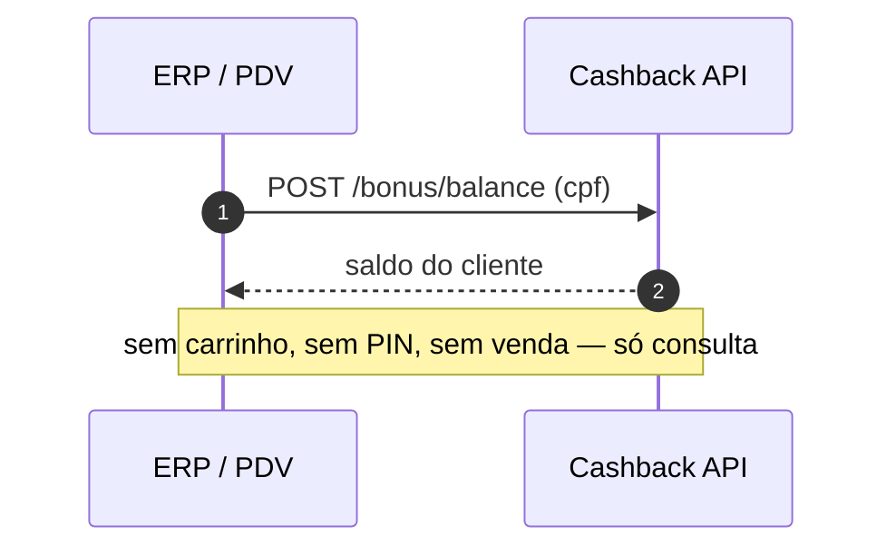

# Consulta de saldo

Para telas **fora do fluxo de venda** — gerência ou balcão consultando quanto
o cliente tem acumulado.

**Endpoint principal:** `POST /bonus/balance`, identificado pelo CPF.

::: warning No caixa, use o /bonus/available
A consulta de saldo **não** responde "quanto posso usar nesta compra" — ela
não conhece o carrinho. No fluxo de compra, use sempre o
[`/bonus/available`](./compra), que considera os itens, os limites e a campanha
da venda atual.
:::

## Visão geral



## Passo a passo

```bash
curl -s -X POST "$BASE_URL/bonus/balance" \
  -H "Authorization: Bearer $TOKEN" -H "Content-Type: application/json" \
  -d '{"cpf":"11144477735"}'
```

Exiba o saldo retornado no `data` — é o total acumulado do cliente na loja.

## Erros

| Resposta | O que fazer |
| --- | --- |
| `400 CPF inválido` | Corrigir o CPF; não repetir igual |
| `404 Cliente não encontrado` | CPF sem cadastro no programa — oferecer o cadastro na próxima venda |

## Checklist

- [ ] Usada apenas fora do fluxo de venda (balcão/gerência)
- [ ] O caixa usa `/bonus/available`, não o `/bonus/balance`
- [ ] `404` tratado como "cliente sem cadastro", não como erro de sistema
