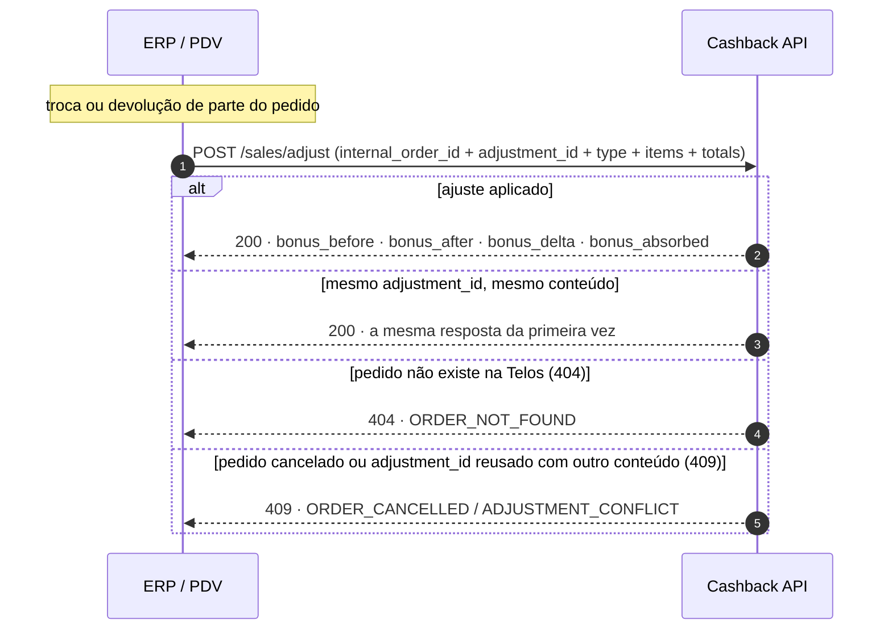

# Troca e devolução parcial

O cliente trocou um produto ou devolveu parte do pedido: o cashback que a
compra gerou precisa acompanhar o novo valor. Para isso existe o ajuste do
pedido.

**Endpoint principal:** `POST /sales/adjust`, identificado pelo
`internal_order_id` do pedido **original** — o mesmo enviado no
`/bonus/submit`.

::: info Devolução de todos os itens não é ajuste
Se o cliente devolveu o pedido inteiro, use o
[Cancelamento de venda](./cancelamento).
:::

## Como funciona

O ERP **não** envia "o que mudou". Envia **como o pedido ficou** depois da
troca ou devolução: todos os itens e os totais, no mesmo formato do
`/bonus/submit`. A Telos recalcula o cashback desse estado com as regras do
pedido original (mesma campanha e mesmo percentual, mesmo que a campanha já
tenha terminado) e aplica a diferença:

- **Cashback maior** (troca por um produto mais caro): a Telos gera um
  **crédito complementar** com a diferença, com prazos contados a partir do
  dia do ajuste. Não sai SMS de confirmação; o valor aparece no saldo do
  cliente.
- **Cashback menor** (troca por um produto mais barato ou devolução parcial):
  a Telos reduz o que ainda está disponível nos créditos do pedido. O que o
  cliente **já usou ou já venceu** não é cobrado dele: a loja assume, e o
  valor volta em `bonus_absorbed`.
- **Mesmo valor:** nada muda no saldo; o pedido fica registrado com os itens
  novos.

O valor mínimo de acúmulo da loja é reavaliado: se uma devolução deixa o
pedido abaixo do mínimo, o cashback dele vai a zero.

Por que o estado final: o ERP já sabe montar esse JSON (é o mesmo do
`/bonus/submit`), duas trocas no mesmo pedido não acumulam erro e reenviar é
seguro.



## Passo a passo

Exemplo: pedido `PED-9002` com blusa de R$ 100,00 e calça de R$ 200,00,
R$ 60,00 pagos com cashback, R$ 240,00 pagos e R$ 24,00 de cashback gerado
(campanha de 10%). O cliente troca a blusa por um vestido de R$ 150,00 e paga
a diferença de R$ 50,00.

::: code-group

```bash [curl]
curl -s -X POST "$BASE_URL/sales/adjust" \
  -H "Authorization: Bearer $TOKEN" -H "Content-Type: application/json" \
  -d '{
    "internal_order_id": "PED-9002",
    "adjustment_id": "TROCA-7781",
    "type": "EXCHANGE",
    "reason": "Troca de tamanho",
    "items": [
      {"sku":"VESTIDO-M","value_of":150.00,"value_per":150.00,"quantity":1},
      {"sku":"CALCA-40","value_of":200.00,"value_per":200.00,"quantity":1}
    ],
    "totals": {"subtotal":350.00,"fee":0,"taxes":0,
               "crm_discounts":60.00,"other_discounts":0,"total":290.00}
  }'
```

```php [Laravel]
$response = Http::withToken($token)->post("$baseUrl/sales/adjust", [
    'internal_order_id' => 'PED-9002',
    'adjustment_id' => 'TROCA-7781',   // número da troca no ERP
    'type' => 'EXCHANGE',
    'reason' => 'Troca de tamanho',
    'items' => [
        ['sku' => 'VESTIDO-M', 'value_of' => 150.00, 'value_per' => 150.00, 'quantity' => 1],
        ['sku' => 'CALCA-40', 'value_of' => 200.00, 'value_per' => 200.00, 'quantity' => 1],
    ],
    'totals' => ['subtotal' => 350.00, 'fee' => 0, 'taxes' => 0,
                 'crm_discounts' => 60.00, 'other_discounts' => 0, 'total' => 290.00],
]);
```

:::

```json
{
    "status": true,
    "message": "Order adjusted",
    "data": {
        "internal_order_id": "PED-9002",
        "adjustment_id": "TROCA-7781",
        "type": "EXCHANGE",
        "bonus_before": 24.00,
        "bonus_after": 29.00,
        "bonus_delta": 5.00,
        "bonus_absorbed": 0.00,
        "bonus_refunded": 0.00,
        "generated_bonus_id": "6m6AU/VuGMZablszkpr8/w==",
        "adjusted_at": "2026-11-13T14:30:00-03:00",
        "warnings": []
    }
}
```

### Campos da requisição

| Campo | Obrigatório | Regra |
| --- | --- | --- |
| `internal_order_id` | sim | Pedido **original**, o mesmo do `/bonus/submit` |
| `adjustment_id` | sim | Identificador único da troca ou devolução no ERP (o número da venda de troca serve). Até 100 caracteres |
| `type` | sim | `EXCHANGE` (troca) ou `RETURN` (devolução sem troca) |
| `reason` | não | Texto livre, até 500 caracteres |
| `items` | sim | **Todos** os itens do pedido depois do ajuste, no formato do `/bonus/submit` |
| `totals.total` | sim | Valor efetivamente pago pelo pedido depois do ajuste. Na troca a maior, soma a diferença paga; na troca a menor e na devolução, desconta o que voltou ao cliente |
| `totals.crm_discounts` | sim | Cashback usado que continua no pedido. Na troca, o mesmo do pedido original |
| demais `totals` | não | Mesmo significado do `/bonus/submit` |

### Campos da resposta

| Campo | Significado |
| --- | --- |
| `bonus_before` | Cashback ativo do pedido antes do ajuste |
| `bonus_after` | Cashback que o pedido tem depois do ajuste |
| `bonus_delta` | Quanto mudou nos créditos do cliente: positivo = crédito complementar; negativo = redução |
| `bonus_absorbed` | Quanto a loja assume no pedido: a redução que não pôde ser aplicada porque o cashback já foi usado ou venceu. **Acumulado do pedido**, somando os ajustes anteriores |
| `bonus_refunded` | Cashback usado devolvido ao saldo do cliente. Hoje sempre `0` |
| `generated_bonus_id` | Crédito complementar, quando houver |
| `warnings` | Avisos com `code` e `detail` que não impedem o ajuste. A lista pode ganhar códigos novos: ignore os que não conhece |

Sempre vale `bonus_after = bonus_before + bonus_delta − bonus_absorbed`.

### Avisos

| `code` | Quando |
| --- | --- |
| `ORDER_WITHOUT_BONUS` | O pedido original não gerou cashback (ex.: abaixo do mínimo). O ajuste não gera cashback para ele |
| `PAYLOAD_INCONSISTENT` | `totals` não fecham com `items`, como no `/bonus/submit` |
| `CRM_DISCOUNTS_CHANGED` | Troca com `crm_discounts` diferente do original. O valor enviado é ignorado |
| `BONUS_RULE_NOT_FOUND` | A campanha do pedido original não existe mais. O cashback não muda |
| `MODE_NOT_SUPPORTED` | O programa da loja é de pontos. O ajuste não altera nada |

## Exemplos

Mesmo pedido de partida: blusa R$ 100,00 + calça R$ 200,00, R$ 60,00 pagos
com cashback, R$ 240,00 pagos, R$ 24,00 gerados (10%, mínimo de acúmulo de
R$ 100,00).

| Caso | `items` | `totals.total` | Resultado |
| --- | --- | --- | --- |
| Troca pelo mesmo valor | blusa nova + calça | 240 | `bonus_delta` 0 |
| Troca a maior | vestido 150 + calça | 290 | `bonus_delta` +5,00, crédito complementar |
| Troca a menor (calça por 120) | blusa + calça 120 | 160 | `bonus_delta` −8,00 |
| Troca a menor, com os R$ 24,00 já usados | blusa + calça 120 | 160 | `bonus_delta` 0, `bonus_absorbed` 8,00 |
| Devolução da calça (`RETURN`) | blusa | 80 (`crm_discounts` 20) | 80 abaixo do mínimo → `bonus_delta` −24,00 |

## Repetição e erros

O mesmo `adjustment_id` com o mesmo conteúdo devolve **200 com a mesma
resposta** e não altera nada: depois de um timeout, reenvie igual. É
diferente do `/bonus/submit` e do `/sales/cancel`, que devolvem 409 na
repetição.

| Resposta | `error.code` | O que fazer |
| --- | --- | --- |
| `200` | — | Pronto. Guarde a resposta junto da troca no ERP |
| `400` | `INVALID_DATA` | Corrigir o payload |
| `404` | `ORDER_NOT_FOUND` | O pedido não tem registro na Telos (não gerou nem usou cashback e não passou pelo `/sales/total`). Não há o que ajustar |
| `409` | `ORDER_CANCELLED` | O pedido foi cancelado. Não há o que ajustar |
| `409` | `ADJUSTMENT_CONFLICT` | O `adjustment_id` já foi usado com outro conteúdo. **Não é sucesso**: cada troca precisa do próprio `adjustment_id` |

## Checklist

- [ ] Ajuste disparado pelo fluxo de troca e de devolução parcial do ERP
- [ ] `internal_order_id` do pedido **original**
- [ ] `adjustment_id` único por troca ou devolução, estável nos reenvios
- [ ] `items` e `totals` com o pedido **inteiro** depois do ajuste
- [ ] `crm_discounts` da troca igual ao do pedido original
- [ ] Devolução de todos os itens vai para o `/sales/cancel`
- [ ] `ADJUSTMENT_CONFLICT` tratado como erro, não como sucesso
